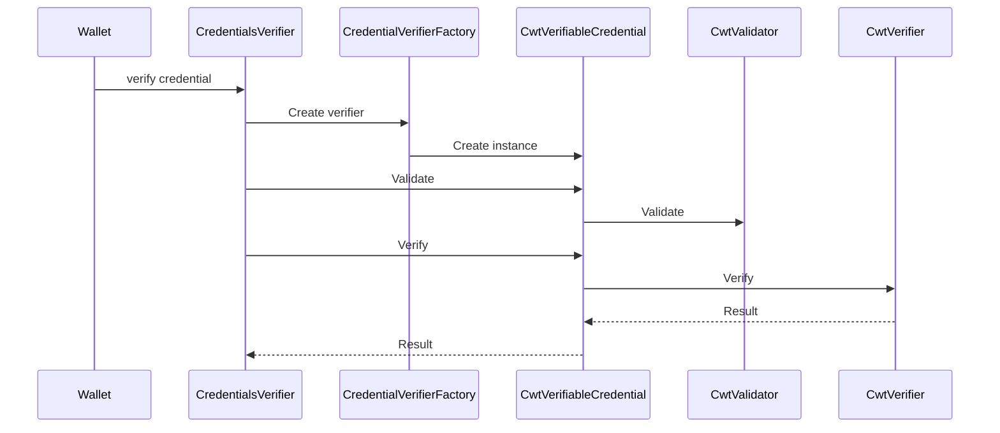
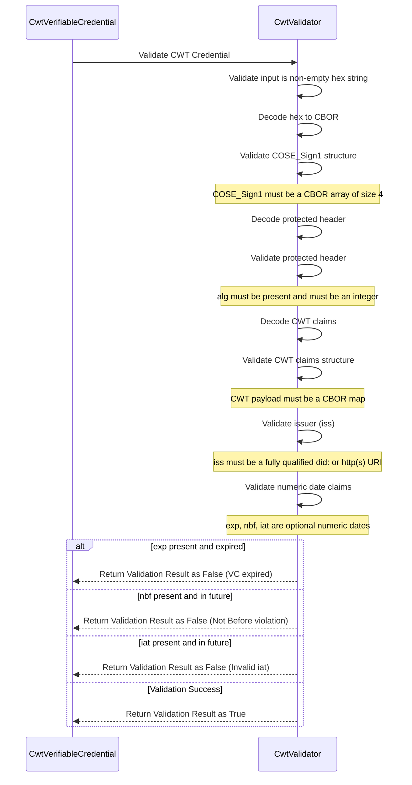
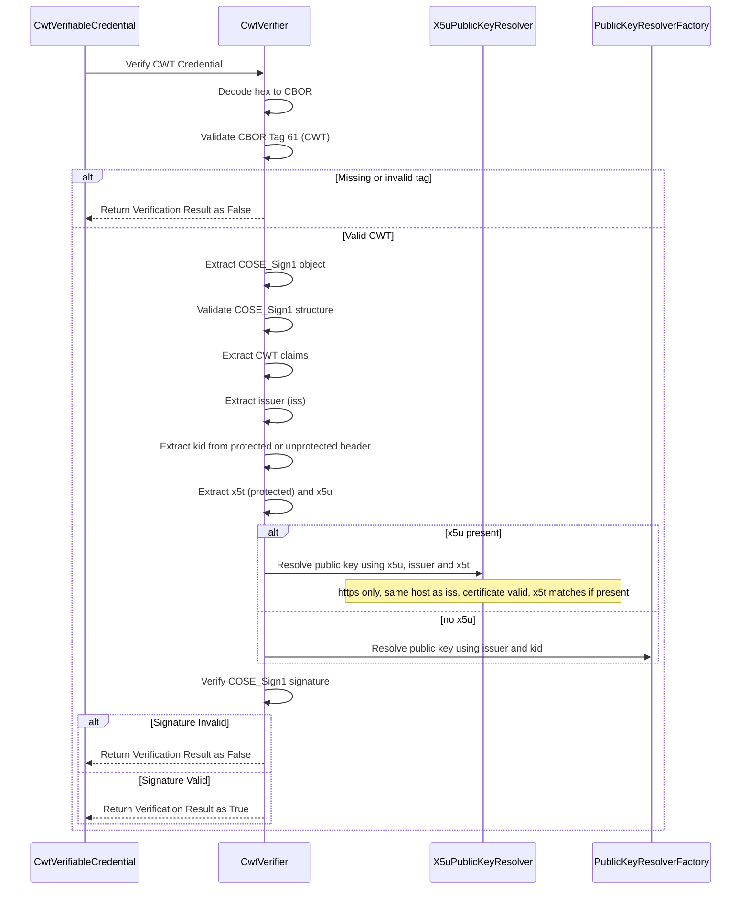

# Support for IETF CWT Verifiable Credential (CWT-VC)

This document provides a comprehensive overview of validating and verifying **CWT-based Verifiable Credentials (cwt-vc)** encoded using **CBOR Web Token (CWT)** and **COSE_Sign1**, as defined by IETF standards.

---

## Public key resolution support

- **`x5u` (COSE header label 35)**
    - Downloads the issuer X.509 certificate and uses its public key.
    - Takes precedence over issuer-based resolution. There is no fallback when `x5u` is present.
    - Protected `x5u` is always read. An unprotected `x5u` is read only when a protected `x5t` is present.
    - Must be an `https` URL on the same host as `iss`, and the certificate must be within its validity period.
- **`x5t` (COSE header label 34, protected header)**
    - Binds the downloaded `x5u` certificate to the signed header. Only SHA-256 (`-16` or `"sha-256"`) is supported.
- **HTTP / HTTPS Issuer**
    - Retrieves issuer public key from `/.well-known/jwks.json` when `iss` is an HTTP(S) URL.
- **DID Issuer**
    - Resolves the public key when `iss` is a `did:web`, `did:key` or `did:jwk` URI.

---

## Steps Involved

1. Added the enum value `CWT_VC("cwt-vc")` to `CredentialFormat`.
2. Created a new class `CwtVerifiableCredential` that implemented the `VerifiableCredential` interface.
    - The `validate` method validated the credential structure and claims.
    - The `verify` method verified the cryptographic signature.
3. Created a `CwtValidator` class to validate the credential structure and claims.
4. Created a `CwtVerifier` class to verify the credential signature.
5. Implemented validation checks for COSE, headers, claims, and numeric date fields.
6. Implemented signature verification using the issuer’s public key.
7. Registered `CwtVerifiableCredential` in `CredentialVerifierFactory`.
8. Added `X5uPublicKeyResolver` and `X5tCertificateMatcher` for COSE based key resolution.
9. Centralised the `iss` rule in `Util.parseFullyQualifiedIssuer`, shared by `CwtValidator` and `CwtVerifier`.

---

## Sequence diagram – validate and verify `cwt-vc` credential

### Sequence diagram - validation process

### Sequence diagram - verification process

---

## Key Validation Rules Summary

### COSE Structure
- Must be a CBOR array of exactly 4 elements.

### Protected Header
- `alg` MUST be present and an integer.

### CWT Claims
- Payload MUST be a CBOR map.
- `iss`, `exp`, `nbf`, `iat` validated as per spec.

### Issuer
- `iss` MUST be a fully qualified `did:` or `http(s)` URI.

### Public Key Resolution
- `x5u` present: resolved from the certificate, no fallback to JWKS or DID.
- Malformed `x5u` or `x5t` fails verification.
- `x5u` MUST be `https` and on the same host as `iss`.
- Certificate MUST be within its validity period and, when `x5t` is present, match its SHA-256 thumbprint.

### Cryptographic Verification
- CBOR tag `61` required.
- Signature verified using COSE_Sign1.

---
